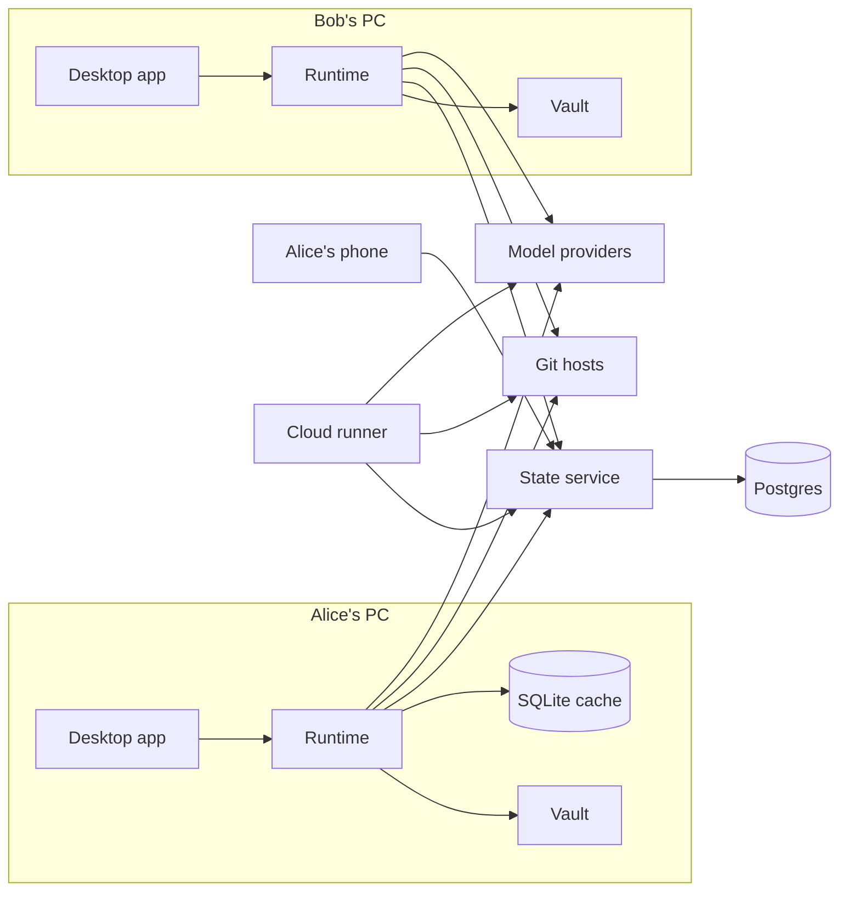

# Architecture

Components, data flow and where each piece of code lives. The spec's text is authoritative;
this file explains the shape of the implementation. Diagram source is at the end (Mermaid).

## Purpose

Each person runs a local Forerunner app. All apps talk to one small shared state service and to
their git hosts. An optional cloud runner executes the same agent runtime when laptops are off.
The runtime is the same code in every run mode; only the storage adapter and the runner change.

## Components

| Component | Code | Responsibility |
| --- | --- | --- |
| Desktop and Android apps | `apps/ui` (React, one UI), `apps/desktop/src-tauri`, `apps/mobile/src-tauri`, `apps/approvals-web` | Screens from spec K, tray with kill switch, pairing, notifications. Android never runs agents. |
| Agent runtime | `packages/runtime` | Capability tokens, enforcement hooks, agent drivers (in-process loop, Claude Agent SDK), model ladder, briefs, context layer, sandboxes, sessions, the `fr` CLI |
| Commands | `packages/commands` | One registry for every action; intent parsing, change cards, risk-based confirmation, change log and undo (spec Q) |
| Shared state | `packages/state` (schema, migrations, SQLite and Postgres adapters, repositories, claims) and `services/state-api` (Hono over Postgres, realtime, receipts, device auth, GitHub mirror) | Source of truth for tasks, messages, claims, costs, reviews, decisions |
| Billing | `packages/billing` | Billing sources, routing policy, pricing, CHF rates, cost ledger, caps, estimate tracking |
| Memory | `packages/memory` | Lessons in three scopes, retrieval under a token budget, consolidation, promotion |
| Critic | `packages/critic` | Independent review by tier, findings, verdicts, calibration |
| Voice | `packages/voice` | STT, TTS, VAD, the voice loop, latency measurement, providers |
| Capabilities | `packages/capabilities` | Browser, email, desktop control, connectors; each an MCP server the runtime grants or revokes; git host adapters |
| Vault | `packages/vault` | OS keychain or encrypted file; secrets by reference, injected into tool calls |
| Platform | `packages/platform` | Paths, shell runner, clock, OS facts, redacting logger |
| Cloud runner | `services/cloud-runner` | Headless runtime image, email command watcher, vault unlock |
| Test environment | `testenv` | Fake provider, simulated clock, fake git host, mail server with DKIM, fake Cloudflare, simulated users |
| Evals | `evals` | Golden task sets, eval runner, registry content (synced to `forerunner-registry`) |

## Daemon and shells

The runtime runs as one `fr daemon` process per install (ADR 0026). It binds the local daemon
API (ADR 0011) on 127.0.0.1 with a bearer token in `<runtime dir>/daemon.json`; the desktop
shell reads that file, starts the daemon when it is missing, and injects the address and token
into the shared UI (ADR 0025). The Android app never talks to the daemon: it pairs with the
state service (ADR 0009) and sends remote commands that the PC's daemon executes. The cloud
runner composes the same runtime headless against the shared Postgres state. Updates are
staged by the runtime itself (ADR 0015); "Update and restart" ends the daemon with exit code
75 and the shell or user service restarts it.

| Piece | Code | Doc |
| --- | --- | --- |
| Composition root and daemon API | `packages/runtime/src/daemon` | runtime.md § Local daemon |
| Extensions registry and MCP connectors | `packages/runtime/src/extensions` | extensions.md |
| Sandboxes | `packages/runtime/src/sandbox` | sandbox.md |
| Updates | `packages/runtime/src/update` | updates.md |
| Model watch and estimates | `packages/runtime/src/models`, `src/estimates` | model-watch.md |
| GitHub Projects mirror | `packages/capabilities/src/githost/projects-mirror.ts` | capabilities.md |

## Data flow of one session

1. A trigger (manual, schedule, inbox event, CI result, PR comment, verified email, remote command from
   the phone) asks the runtime to start a session for an agent.
2. The startup checklist runs as code: version check, git fetch, pull shared state, inbox, open human
   requests, critic findings, budget, diff since last session. Output: a compact state brief.
3. The principal agent (an SDK or loop run with a capability token) plans within its session budget
   and writes the plan; at autonomy 0–1 the plan waits for approval.
4. For each task: claim (atomic, expiring), delegate with a validated brief to a specialist run with a
   derived token (narrower tools, paths, domains, secrets, budget; depth + 1), execute in a sandbox,
   open a PR through the git host adapter, request a critic review at the task's tier.
5. Every model call passes `beforeModelCall` (kill state, wall clock, steps, caps) and every tool call
   passes `beforeToolCall` / `afterToolCall` (allowlist, paths, domains, autonomy, secrets, injection
   wrapping, audit). Costs go to the ledger in USD micro-units with CHF at the day's rate.
6. Session end: docs, task states, memory, project summary, cost ledger updated; handoff message to the
   peer; notification to the human.

## Source of truth

| Data | Lives in |
| --- | --- |
| Code, project docs, ADRs | git |
| Tasks, milestones, messages, claims, costs, reviews, decisions | shared state service (Postgres), or local SQLite in solo mode |
| Private agent memory | owner's machine |
| Critic memory, shared lessons | shared state service |
| Secrets | vault, referenced by name |
| Large data | where it sits, registered by path or URI |

## Run modes

| Mode | Runtime on | State |
| --- | --- | --- |
| Solo local | the PC | local SQLite (`sqlite:<path>`) |
| Paired local | each PC | state service (`postgres://` through `services/state-api`) |
| Hybrid | PC when on, cloud runner when off | state service |
| Cloud only | cloud runner | state service |

## How to change it

Add a component under its directory with its maintainer doc; wire it through the runtime's ports
(`packages/runtime/src/enforcement/ports.ts`) rather than importing databases directly; keep OS
differences in `packages/platform`.

## Tests

Each package tests itself; `tests/e2e` runs the nine scenarios across the whole system.

## Diagram source

